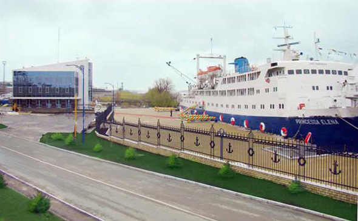

Preluarea operatorului Portului Internațional Liber Giurgiulești de către compania care administrează portul Constanța a fost însoțită de o lege nouă, dispute între acționarii cumpărătorului și stingerea unor litigii mai vechi. În centrul tranzacției se află o întrebare de interes public: în ce condiții va fi administrată pe termen lung poarta maritimă a Moldovei?

<!--more-->

<figure class="post-image" style="float:right; width:min(100%, 350px); margin:0 0 1rem 1.25rem; padding:6px; border:1px solid #ddd;">
  
  <figcaption>Terminalul de pasageri de la Giurgiulești, în 2013.<small style="display:block; margin-top:3px; font-size:10px; line-height:1.3; font-style:normal; color:#777;">Foto: Spiridon Ion Cepleanu · CC BY-SA 3.0</small></figcaption>
</figure>

În aprilie 2026, Administrația Porturilor Maritime Constanța (APM), controlată de statul român, a cumpărat de la Banca Europeană pentru Reconstrucție și Dezvoltare (BERD) compania Danube Logistics, operatorul portului internațional liber. [BERD precizează](https://www.ebrd.com/home/news-and-events/news/2026/ebrd-completes-landmark-exit-from-giurgiulesti-international-fre.html) că a vîndut 100% din participația sa după o procedură competitivă internațională.

Tranzacția privește firma care conduce activitatea portului. Terenurile publice rămîn în proprietatea Republicii Moldova, care își păstrează dreptul de a aplica propriile legi pe teritoriul portului. Acesta fusese dezvoltat de investitori privați, iar BERD era proprietarul operatorului din 2021. La Giurgiulești există și un port de stat distinct de portul internațional liber.

## O regulă specială, pusă sub semnul întrebării

La 26 martie 2026, Parlamentul Moldovei a adoptat [Legea nr. 39](https://bizlex.ru/ro/document/39-26-03-2026-lege-pentru-modificarea-legii-nr-8-2005-cu-privire-la-portul-internat-ional-liber-giurgiules-ti), care modifică legea portului. O parte dintre prevederi se aplică înainte de 2030; altele intră în vigoare la 18 februarie 2030.

În [documentul cu observațiile instituțiilor](https://particip.gov.md/ro/download_attachment/31677), Ministerul Justiției a atras atenția asupra unei reguli speciale: terenurile urmau să fie date în folosința investitorului general printr-o excepție de la regulile obișnuite pentru proprietatea publică. Ministerul a avertizat că soluția poate afecta accesul egal la bunurile publice, concurența și transparența. La sfîrșitul anului 2025, în port activau 74 de companii. Ministerul a cerut autorilor să explice mai bine de ce este necesară excepția.

Autorii proiectului au invocat acordurile de investiții existente și necesitatea de a asigura funcționarea portului după 2030. Regula specială a fost păstrată. Ulterior, același minister a comunicat că nu are obiecții de principiu față de text. Avertismentele sale inițiale nu reprezintă o decizie a unei instanțe că legea ar fi ilegală.

## Cine plătește terenurile și ce primește investitorul

Legea permite extinderea portului pînă la 120 de hectare. Dacă pentru extindere este nevoie de terenuri private, statul le poate prelua pentru utilitate publică și plătește despăgubiri proprietarilor. Terenurile rămîn ale statului, dar investitorul general primește prin contract un drept de folosință și de construire, numit „superficie”, pînă la 31 decembrie 2075. Nu este vorba despre vînzarea terenurilor către investitor.

În documentele de avizare, autorii proiectului arătau că existau titluri executorii pentru majoritatea terenurilor și că fuseseră efectuate plăți din buget. În septembrie 2026, [Agenția Proprietății Publice](https://app.gov.md/proces-istoric-terenuri-port-liber-international-giurgiulesti-finalizare/) a anunțat aprobarea exproprierii unui teren de 0,6 hectare, omis din lista inițială a extinderii începute în 2008. Proprietarul urma să fie despăgubit înainte de expropriere.

Documentele citate nu stabilesc costul total al exproprierilor și nici toate condițiile financiare ale contractului de superficie. Prin urmare, din aceste acte nu se poate calcula exact cît plătește statul și ce oferă investitorul în schimb.

## Protecție pentru investitor pînă în 2050

Din 2030, o prevedere nouă va proteja investitorul și firmele din port dacă statul schimbă regulile în defavoarea condițiilor lor de activitate: în asemenea situații, pentru ei se vor aplica prevederile legii portului pînă la sfîrșitul anului 2050. Există o excepție pentru schimbările necesare alinierii la legislația Uniunii Europene. Protecția nu înseamnă că operatorul este scutit de toate celelalte obligații legale.

O altă întrebare este ce va afla publicul despre activitatea portului. Centrul Național Anticorupție a recomandat rapoarte regulate și publicarea lor pe pagina web. Potrivit [sintezei consultărilor](https://particip.gov.md/ro/download_attachment/31677), autorii au răspuns că raportul va ajunge la Guvern, care decide publicarea. Din 2030, legea prevede ca reprezentantul Guvernului să prezinte anual rapoarte despre port și propria activitate, fără o obligație expresă de publicare. Pentru a vedea rapoartele, publicul va depinde astfel de decizia autorităților sau de cereri de acces la informație.

## Prețul, prognozele și disputa dintre acționari

Fondul Proprietatea, acționar minoritar al APM, a contestat în instanță decizia de achiziție și finanțarea ei. Potrivit [Profit.ro](https://www.profit.ro/povesti-cu-profit/auto-transporturi/ultima-ora-romania-face-ultimii-pasi-pentru-a-prelua-portul-giurgiulesti-din-republica-moldova-22313943), o ofertă anterioară se ridica la aproximativ 62 de milioane de dolari și includea angajamente suplimentare de investiții. Această cifră este cea a ofertei relatate de presă, nu o confirmare a prețului final din contract.

Fondul a susținut că evaluarea se baza pe un scenariu optimist, inclusiv o creștere a volumelor operate cu 80% pînă în 2030. APM a apărat achiziția. Într-un litigiu separat privind majorarea capitalului, [presa locală](https://www.replicaonline.ro/fondul-proprietatea-vrea-sa-anuleze-hotararea-prin-care-a-fost-majorat-capitalul-social-al-portului-constanta-658732) a relatat despre contestațiile fondului și despre deciziile instanțelor care au permis continuarea operațiunii. Aceste obiecții sînt poziția unui acționar, nu o hotărîre definitivă că tranzacția ar fi fost nelegală.

## Litigiile Bemol și condițiile înțelegerii

Un alt obstacol privea disputele mai vechi legate de Danube Logistics. Potrivit relatărilor bazate pe informații de la Bemol și pe analiza dosarelor, compania a anunțat soluționarea disputei și retragerea proceselor și a restricțiilor asupra bunurilor. [Realitatea.md](https://realitatea.md/bemol-isi-retrage-toate-pretentiile-si-deblocheaza-tranzactia-portul-international-giurgiulesti-are-un-nou-proprietar/) relatează că au fost ridicate inclusiv restricții asupra capitalului Danube Logistics.

Condițiile înțelegerii și eventualele compensații nu sînt explicate în relatarea publică. Retragerea măsurilor a înlăturat un obstacol, dar nu arată, prin ea însăși, ce au convenit părțile sau cine a suportat eventuale costuri.

## Referirea la ReArm și statutul demilitarizat

În documentele unui proces citate de [Profit.ro](https://www.profit.ro/povesti-cu-profit/auto-transporturi/ultima-ora-romania-face-ultimii-pasi-pentru-a-prelua-portul-giurgiulesti-din-republica-moldova-22313943), APM a afirmat că demersurile guvernului român pentru a aduce bani noi în companie vizau achiziția și alte proiecte de investiții asociate ReArm Europe și infrastructurii cu utilizare civilă și militară.

Această referire nu identifică un proiect militar la Giurgiulești și nu demonstrează transportul de armament prin port. Legea portului îl declară zonă demilitarizată și interzice producerea, tranzitarea și păstrarea armamentului, precum și dislocarea unităților militare. Rămîne o distincție esențială între planurile generale de finanțare ale cumpărătorului și ceea ce legea permite efectiv pe teritoriul portului moldovenesc.

## Constanța și Giurgiulești, sub același control

[Guvernul român](https://agerpres.ro/comunicate/2026/04/21/comunicat-de-presa---guvern--1548683) a prezentat achiziția drept o modalitate de consolidare a rolului Constanței ca nod regional. BERD și noul proprietar au anunțat obiective de extindere a capacității și modernizare a infrastructurii.

În același timp, operatorul de la Giurgiulești se află acum sub controlul companiei care administrează Constanța. Această concentrare poate aduce cooperare logistică, dar ridică și întrebări despre modul în care vor fi stabilite investițiile, tarifele și prioritățile comerciale ale celor două porturi. Răspunsurile depind de contracte, de deciziile viitoare ale operatorilor și de aplicarea normelor de concurență.

Miza pentru Moldova nu se reduce la schimbarea proprietarului unei companii. Ea privește și costurile publice ale terenurilor, drepturile acordate pentru decenii și accesul publicului la informații despre administrarea unei infrastructuri strategice.
