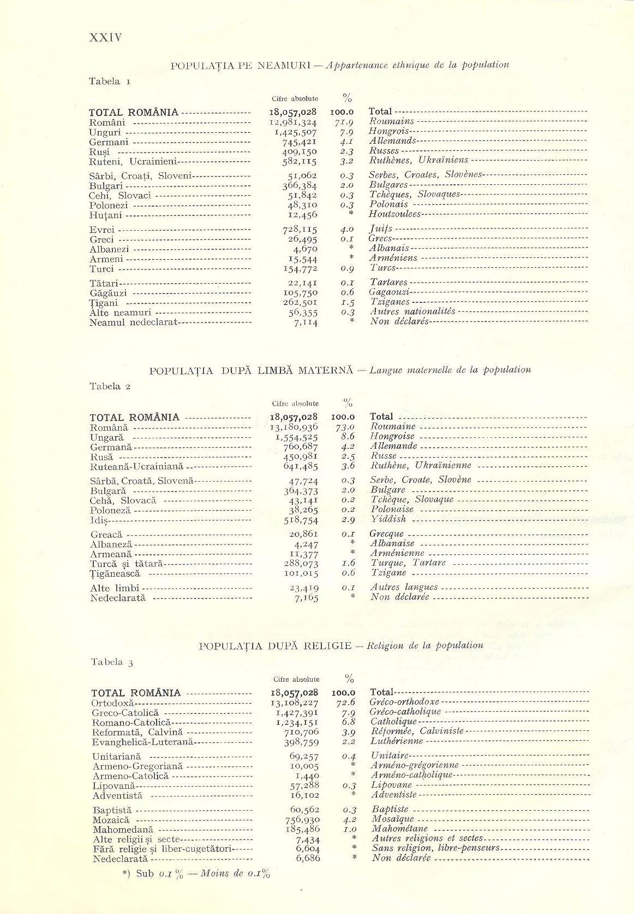
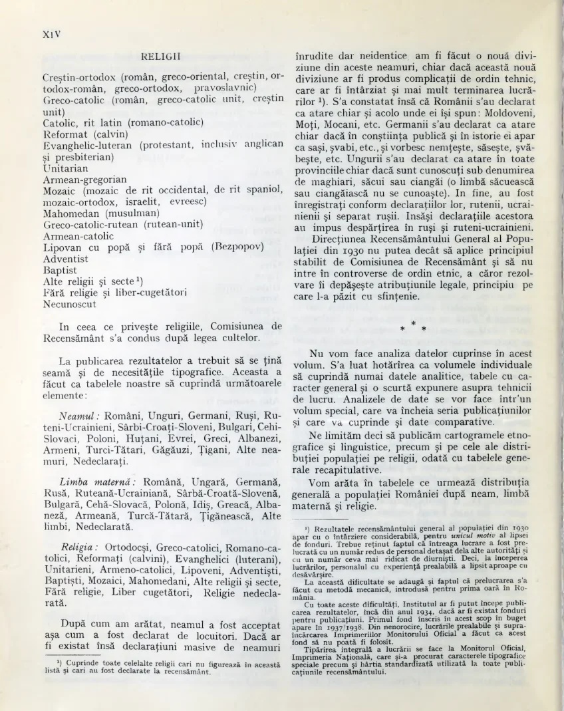
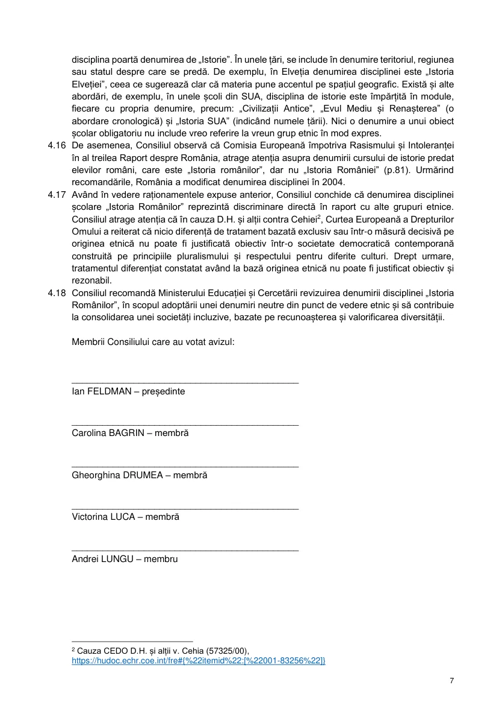
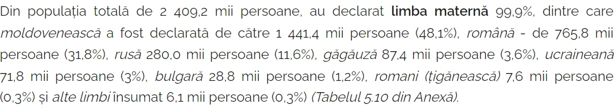

Moldovenii își spun numele, iar instituțiile îl înlocuiesc. Într-un recensămînt, identitatea lor este absorbită în altă categorie. În legislație, numele limbii este substituit. În diplomație, se cere recunoașterea „inexistenței” ei. În școli, se retrag denumiri și se înlocuiesc manuale. Privite împreună, aceste cazuri arată caracterul sistematic al unei lupte împotriva recunoașterii identității moldovenești: aceeași identitate este contestată și redusă în mai multe domenii ale vieții publice.

<!--more-->

<figure class="post-image" style="float:right; width:min(100%,350px); box-sizing:border-box; margin:0 0 1rem 1.25rem; padding:6px; border:1px solid #ddd;">

<figcaption>Recensămîntul din 1930, vol. II, ediția din 1938, p. XXIV.<small style="display:block;font-size:10px;color:#777;">Reproducere: Mihai Andrei / Wikimedia Commons · domeniul public.</small></figcaption>
</figure>

Ceea ce leagă exemplele este o practică repetată: denumirea moldovenească este declarată regională, depășită ori artificială, apoi înlocuită printr-o categorie considerată obligatorie. Puterea de a defini trece de la oamenii care își afirmă identitatea la instituțiile care îi clasifică.

Prin „identitate moldovenească” înțelegem aici identificarea etnică asumată și denumirea moldovenească a limbii, fiecare cu propriile sale dovezi. Cetățenia, domiciliul și originea geografică sînt alte caracteristici. Tocmai confundarea lor permite ca o comunitate să fie recunoscută numai ca populație a unui teritoriu, în timp ce identificarea sa etnică proprie este contestată.

Exemplele următoare arată cum funcționează această substituire: în statistici, în interpretarea istoriei, în drept, în relațiile dintre state și în educație.

## 1. 1930: dispariția din condei

În [volumul II al recensămîntului din 29 decembrie 1930, publicat în 1938](https://bibgtkneamt.ebibliophil.ro/d.php?l=bjn_recansamant-1930-vol-2-pdf-jwg553k9), statul român nu publică rubrici distincte pentru moldoveni și limba moldovenească. [Pagina XXIV](https://commons.wikimedia.org/wiki/File:Recensamant1930-II-XXIV.jpg) permite verificarea directă a listei.

Absența este cu atît mai semnificativă cu cît Sabin Manuilă, directorul recensămîntului, recunoaște în prefață existența numelui prin care oamenii se identificau: „chiar şi acolo unde ei îşi spun: Moldoveni, Moţi, Mocani”. Tot el afirmă că acești locuitori s-au declarat români la recensămînt. **Oamenii își spun moldoveni, dar în rezultatul publicat nu mai au identitate distinctă: aceasta este contradicția pe care explicația oficială o lasă nerezolvată.**

<figure class="document-image" style="max-width:480px;">

<figcaption>Prefața, p. XIV: numele moldovenesc apare în explicația autorului, fără a primi o rubrică distinctă în tabelele generale.<small>Sursa: Institutul Central de Statistică / Biblioteca Județeană G. T. Kirileanu Neamț · document statistic oficial, domeniul public.</small></figcaption>
</figure>

Această încadrare nu este neutră. Așezarea moldovenilor lîngă moți și mocani îi tratează ca o subdiviziune regională în interiorul națiunii definite de stat. Posibilitatea unei identificări moldovenești etnice distincte este înlăturată din prezentarea generală a rezultatelor.

De ce ar trebui acceptată fără probe ideea că o identificare recunoscută chiar de organizator a dispărut din declarațiile relevante pentru clasificare? Prefața nu publică o demonstrație a acestei presupuse renunțări colective la numele moldovenesc. O afirmă și cere cititorului să creadă instituția care a produs rezultatul.

**Absența unei rubrici nu înseamnă absența oamenilor și nici absența declarațiilor moldovenești.** Tabelul general nu ne spune cîți au răspuns „moldovean”, cum au fost codificate asemenea răspunsuri sau dacă au fost absorbite în altă categorie. Pentru aceste întrebări, proba este în buletine și în regulile efective de prelucrare. Explicația directorului nu poate ține locul lor.

Sarcina justificării aparține instituției care a înlăturat categoria distinctă. O comunitate nu poate fi declarată dispărută numai fiindcă statul nu i-a rezervat o rubrică. Faptul documentat rămîne brutal: **în aceste tabele, statul român nu le oferă posibilitatea de a exista statistic sub propriul nume**, deși numele este recunoscut în aceeași publicație.

Cînd această publicație este folosită ulterior pentru a susține că moldovenii nu existau ca identificare proprie, absența produsă de clasificare devine argument împotriva identității excluse. Statistica ajunge să legitimeze propria ei omisiune.

## 2. Pretextul „inventării”

Una dintre formulele cele mai răspîndite împotriva identității lingvistice moldovenești este că limba ar fi fost „inventată” în RASSM. Formula confundă existența unei limbi și a numelui ei cu politicile aplicate ulterior vocabularului, scrierii și normei literare.

Chiar Ioana Vintilă-Rădulescu, într-un studiu care susține unitatea lingvistică a celor două spații, precizează că termenul și conceptul de limbă moldovenească [„nu sunt o invenţie recentă, ci au antecedente mai vechi”](https://www.limbaromana.md/index.php?go=articole&n=2508). Cercetarea lui Nicolae Fustei despre tiparul bisericesc [consemnează gramatica din 1819 cu traducere în limba moldovenească](https://biblioteca-digitala.ro/reviste/codrul-cosminului/19_codrul-cosminului_vol-19-nr-1-iulie_2013.pdf), cu mult înaintea înființării RASSM.

În anii 1920–1930 s-au făcut intervenții radicale asupra normei promovate în RASSM. [Lidia Codreanca documentează, pentru 1926–1932](https://philologia.usm.md/files/journals/arhiva/total/philologia_1-2--2019.pdf), încercările de a alcătui terminologie prin derivare, calchiere și relexicalizare, folosind graiul viu și grafia rusă. Studiul discută construcția unei norme și a unui lexic terminologic. Aceste operații presupun un material lingvistic existent asupra căruia se intervine.

Rusismele, calcurile și formele artificiale pot schimonosi o limbă. Critica lor trebuie îndreptată asupra intervențiilor și a autorilor lor. Din deformarea vocabularului nu rezultă că limba vorbită de populație, denumirea ei și întreaga tradiție moldovenească ar fi apărut atunci, din nimic.

Comparația cu influența franceză arată de ce este necesar același criteriu. [Cosmina Simona Lungoci studiază franțuzismele din textele secolului al XIX-lea](https://www.diacronia.ro/ro/indexing/details/A12931/pdf), inclusiv forme intermediare, insuficient adaptate și construcții influențate de franceză. Unele forme au intrat în uz, altele au dispărut. Exemple precum *a se mefia* și *a compta* arată cît de vizibil putea deveni modelul străin în exprimare.

Într-un caz, asemenea schimbări sînt discutate ca împrumut, franțuzire, modernizare sau exces lexical. În cazul moldovenesc, intervențiile din RASSM sînt invocate pentru a declara inventată limba în ansamblu. **Aici apare dubla măsură: influența străină este tratată fie ca un episod din istoria unei limbi, fie ca pretext pentru anularea existenței ei.**

Comparația privește acest raționament, iar politicile concrete se cercetează în împrejurările fiecărei epoci. O normă poate fi modificată prin decizie politică; istoria limbii și a denumirii sale nu începe cu acea decizie.

## 3. Numele șters prin lege

[Hotărîrea nr. 36 din 5 decembrie 2013](https://constcourt.md/ccdocview.php?docid=476&l=ro&tip=hotariri) conține două niveluri care trebuie citite separat. Dispozitivul stabilește că, în cazul divergențelor dintre Declarația de Independență și Constituție, prevalează Declarația. În motivare, la paragraful 124, majoritatea Curții aplică această regulă denumirii limbii. Tocmai trecerea de la regula generală la presupusul conflict lingvistic trebuie examinată.

[Declarația din 27 august 1991](https://new.constcourt.md/pageview.php?id=276&idc=11&l=ro) nu cuprinde un articol distinct care să decreteze limba de stat. Mențiunea lingvistică se află într-o frază care începe cu „REAMINTIND”: aceasta evocă aspirațiile mișcării de eliberare națională și documentele prin care s-ar fi exprimat ele, inclusiv actele despre limbă și alfabet din 31 august 1989. În aceeași enumerare apar drapelul, stema și schimbarea denumirii statului.

Prin urmare, formularea despre limbă este parte din relatarea unor evenimente și acte anterioare. A o desprinde din această construcție și a o trata ca pe o nouă decretare a limbii de stat schimbă funcția pasajului: o referire istorică este ridicată la rangul unei norme care înlătură textul expres al Constituției.

Mai există o contradicție pe care o asemenea lectură trebuie să o explice. [Legea nr. 3464 din 31 august 1989](https://bibliotecapublicadrept.wordpress.com/wp-content/uploads/2022/08/statutul-limbii-de-stat-a-rss-moldovenesti-.pdf), la care trimite contextul Declarației, consacra explicit limba moldovenească drept limbă de stat. Invocarea actelor din 1989 pentru a elimina tocmai denumirea pe care ele o stabileau răstoarnă conținutul juridic al trimiterii.

Obiecția a fost formulată chiar în interiorul Curții. În [opinia sa separată, punctele 17–19](https://constcourt.md/ccdocview.php?docid=476&l=ro&tip=hotariri), judecătorul Aurel Băieșu arată că actele de referință din 1989 consacră denumirea moldovenească și contestă acordarea unei valori superioare simplei mențiuni din Declarație. La punctul 26, el apreciază că autorii sesizărilor urmăreau modificarea articolului 13 prin interpretare, ocolind procedura revizuirii Constituției.

**Critica privește construirea conflictului însuși:** dacă fraza introductivă reamintește acte anterioare, fără să instituie o nouă regulă lingvistică, ce normă contrară articolului 13 ar fi trebuit să prevaleze? În această lectură critică, conflictul apare prin transformarea fragmentului narativ într-o normă autonomă. Majoritatea Curții a adoptat interpretarea opusă, calificînd pasajul drept normă primară imperativă. Faptul că interpretarea a devenit obligatorie nu înlătură disputa asupra temeiului ei textual.

Legea nr. 52 din 16 martie 2023 a impus ulterior substituirea denumirilor în actele normative. Numele moldovenesc a fost înlocuit prin „limba română”. În [hotărîrea din 2024](https://constcourt.md/libview.php?id=2795&idc=7&l=ro), Curtea a tratat substituirea ca executare a jurisprudenței sale; separat, a invalidat eliminarea formulării despre grafia latină.

Lanțul este astfel vizibil: o mențiune dintr-o frază istorică primește prin interpretare forța de a înlătura o denumire constituțională expresă, iar apoi această interpretare justifică înlocuirea numelui în legislație. A numi rezultatul „modificare tehnică” ascunde miza pasului inițial: **cine și prin ce lectură a textului a creat temeiul pentru scoaterea numelui moldovenesc din lege?**

## 4. Diplomația „inexistenței”

La 12 aprilie 2023, Bogdan Aurescu a reiterat în discuția cu ministrul ucrainean Dmytro Kuleba cererea privind recunoașterea inexistenței așa-zisei limbi moldovenești. Solicitarea figurează în [comunicatul MAE român](https://www.mae.ro/node/61623), [reprodus de Ziarul de Gardă](https://www.zdg.md/importante/ministrul-roman-de-externe-cere-autoritatilor-ucrainene-sa-adopte-masurile-necesare-pentru-recunoasterea-inexistentei-asa-zisei-limbi-moldovenesti/).

Formularea contează și își trădează propria confuzie. Dacă, așa cum susțin autoritățile române, cele două denumiri desemnează aceeași limbă, atunci obiectul lingvistic există sub ambele nume. În această premisă, a cere „inexistența” limbii moldovenești este la fel de incoerent ca a cere inexistența aceleiași limbi sub denumirea românească. Schimbarea numelui nu face să dispară limba vorbită.

O cerere coerentă cu premisa identității lingvistice ar putea viza nerecunoașterea unei limbi *distincte* ori respingerea denumirii moldovenești în uzul oficial. Acestea sînt însă propoziții diferite de declararea inexistenței limbii. Formula diplomatică le amestecă și prezintă refuzul unui nume drept verdict asupra existenței a ceea ce numele desemnează.

**Oamenilor li se spune că limba lor nu există, cînd disputa privește numele pe care instituția acceptă să-l folosească.** Aceasta este o imprecizie gravă într-un discurs oficial care pretinde rigoare științifică. Competența formulării se judecă după text: diplomația cere negarea, în loc să definească exact ce contestă. Refuzul denumirii moldovenești devine astfel obiectiv al relației dintre guverne, acoperit de retorica „inexistenței”.

La 10 octombrie 2023, [declarația comună Iohannis–Zelenski](https://www.president.gov.ua/en/news/spilna-zayava-prezidenta-ukrayini-volodimira-zelenskogo-i-pr-86229) a cerut guvernelor rezolvarea fără întîrziere a distincției lingvistice, calificată de semnatari drept artificială. Astfel, poziția este înscrisă într-un document politic bilateral.

În noiembrie, [TVR consemna și declarația purtătorului de cuvînt al MAE român, Radu Filip](https://tvrinfo.ro/radu-filip-mae-este-o-dovada-stiintifica-solida-ca-limba-moldoveneasca-nu-exista-exista-doar-limba-romana_942209/), care susținea inexistența limbii moldovenești invocînd identitatea lingvistică dintre Moldova și Valahia în scrierile lui Cantemir.

Se face astfel un salt de la apropierea sau unitatea lingvistică la anularea legitimității unei denumiri proprii. Disputa depășește cercetarea limbii: autoritatea diplomatică intervine pentru a decide cum are voie să fie reprezentată comunitatea în alt stat.

## 5. Manuale retrase, funcționari amenințați

La 16 noiembrie 2023, [Ministerul Educației și Științei al Ucrainei anunța](https://www.kmu.gov.ua/en/news/ofitsiina-zaiava-shchodo-vykorystannia-v-ukraini-poniattia-rumunska-mova-zamist-poniattia-moldovska-mova) înlocuirea termenului moldovenesc cu cel românesc. Comunicatul preciza trei măsuri: alinierea actelor normative, răspunderea disciplinară a funcționarilor care încalcă decizia și oprirea tipăririi suplimentare a manualelor cu denumirea moldovenească. Era pregătită și înlocuirea exemplarelor deja tipărite.

Acesta este un exemplu complet al trecerii de la discurs la constrîngere administrativă. Poziția negociată la nivel politic produce reguli pentru documente, pentru funcționari și pentru școală.

Manualul poartă și un mesaj de recunoaștere. Înlocuirea denumirii îi spune elevului care este numele acceptat instituțional pentru limba lui. Pentru familiile care o numesc moldovenească, propria formulare este îndepărtată din instrumentul public de educație.

Răspunderea disciplinară anunțată privește funcționarii care aplică decizia. Tocmai această precizare face mecanismul concret: administrația este obligată să reproducă noua terminologie, iar menținerea celei moldovenești devine abatere de la regula oficială.

## 6. Coduri retrase, nume absorbit

La 3 noiembrie 2008, codurile `mo` și `mol` au fost retrase din uzul curent al standardului ISO 639. [Registrul Bibliotecii Congresului](https://www.loc.gov/standards/iso639-2/php/code_changes.php) indică folosirea codurilor comune, precizînd totodată că înregistrările vechi rămîn valide. [Glottolog](https://glottolog.org/resource/languoid/id/mold1248) prezintă moldoveneasca drept dialect și consemnează reunirea codului.

Aici, diminuarea recunoașterii operează prin infrastructura clasificării. O intrare care avea un identificator propriu este reunită cu alta. Sistemele care preiau strict lista curentă pot să nu mai ofere o opțiune moldovenească distinctă.

O asemenea decizie tehnică are consecințe culturale atunci cînd structura listei este tratată ca verdict despre dreptul oamenilor de a-și numi limba. Codificarea informatică ajunge să fie folosită pentru a valida sau a respinge o identificare.

Există o diferență între o convenție de clasificare și fidelitatea față de persoană sau document. Titlul unei cărți, citatul unui autor și declarația unui vorbitor trebuie păstrate în forma lor. Substituirea lor prin eticheta curentă ar face să dispară din afișare tocmai mărturia istorică pe care catalogul ar trebui să o conserve.

## 7. BNS: numele absorbit

În [precizările din 10 februarie 2025](https://statistica.gov.md/index.php/ro/precizarile-bns-privind-caracteristicile-etnoculturale-din-cadrul-recensamantulu-12_61647.html), BNS afirmă că înregistrează răspunsurile privind limba conform declarației persoanei. Instituția explică și reunirea răspunsurilor moldovenești și românești sub denumirea oficială a limbii de stat.

Mecanismul este ușor de urmărit: omul declară o denumire, iar în prezentarea agregată răspunsul său contribuie la un total numit prin cealaltă denumire. Opțiunea moldovenească rămîne în datele detaliate, dar este absorbită în eticheta folosită pentru sinteză.

Această operație schimbă ceea ce vede publicul. Un total care reunește două răspunsuri poate fi citit drept număr al persoanelor care au ales un singur nume. Astfel, o declarație moldovenească ajunge să alimenteze o prezentare în care identitatea sa lingvistică distinctă nu mai este vizibilă.

Regula corectă de prezentare este simplă: să fie afișate cele două componente, denumirile declarate și motivul însumării. O analiză despre comunicarea lingvistică și una despre numele prin care oamenii se identifică au obiecte diferite. Folosirea primeia pentru a o înlocui pe a doua îi atribuie respondentului o alegere pe care nu a făcut-o.

## 8. Școala cu etnie în titlu

În Republica Moldova, disciplina școlară oficială se numește **„Istoria românilor și universală”**. Aceasta este denumirea din [curriculumul național pentru liceu](https://mecc.gov.md/sites/default/files/istoria_curriculum_liceu_rom.pdf), care o include în trunchiul obligatoriu. Ea apare și în [Planul-cadru pentru anul de studii 2026–2027](https://www.mec.gov.md/sites/default/files/planul-cadru_2026-2027_09_09_2026.pdf). Este, așadar, o alegere a statului pentru școala publică, nu numai titlul unei cărți sau opțiunea unui profesor.

Titlul alege un grup etnic ca subiect privilegiat al istoriei. Pentru elevii care se identifică moldoveni, ucraineni, găgăuzi, ruși, bulgari, romi sau altfel, întrebarea este directă: de ce istoria comună predată de stat poartă numele unei singure etnii? Republica Moldova este patria tuturor cetățenilor săi, iar apartenența la comunitatea politică nu cere adoptarea aceleiași identități etnice.

Adăugarea cuvintelor „și universală” nu înlătură alegerea inițială. Din multitudinea comunităților, una este numită separat; celelalte intră în categoria generală. Nici includerea unor lecții despre alte comunități nu schimbă ierarhia simbolică din titlu. Problema este cine dă numele istoriei comune și cine este reprezentat numai în interiorul ei.

Această obiecție are și un document instituțional precis. În [avizul consultativ din 15 mai 2025, cauza nr. 150/20](https://egalitate.md/wp-content/uploads/2021/01/150_20_Aviz_votat.pdf), Consiliul pentru egalitate conchide că denumirea „Istoria Românilor” reprezintă discriminare directă față de alte grupuri etnice și recomandă o denumire neutră etnic. Actul consemnează și denumirea completă invocată de minister, precum și argumentul acestuia că materia include istorie locală și conținuturi despre minorități. Consiliul apreciază că titlul poate rămîne etnocentric chiar în prezența unor asemenea conținuturi.

<figure class="document-image" style="max-width:480px;">

<figcaption>Avizul consultativ din cauza nr. 150/20, p. 7: concluzia privind discriminarea și recomandarea unei denumiri neutre etnic.<small>Sursa: Consiliul pentru egalitate · reproducere a unui document oficial.</small></figcaption>
</figure>

Comparația europeană este documentată și în [colecția de coperte și denumiri publicată pe dudnic.com la 22 noiembrie 2019](https://dudnic.com/2019/11/22/denumirea-obiectului-scolar-de-istorie.html). Cititorul poate vedea formule generice precum *History*, *Geschichte*, *Histoire*, *Istorie*, dar și formule teritoriale: *Istoria Rusiei*, *Istoria Ucrainei*, *Istoria și geografia Portugaliei*. Chiar România figurează cu denumirea „Istorie”. Niciunul dintre aceste exemple nu atribuie disciplina unei singure etnii.

[Studiul asociat colecției](https://dudnic.com/istoria/md.html) califică Republica Moldova drept unica țară europeană care păstrează elementul etnic în denumirea disciplinei. Este concluzia comparației publicate, datate, și trebuie citită în raport cu materialele reunite acolo. Colecția include și spațiul caucazian, unde titlul armean „Հայոց պատմություն”, redat în pagină ca „Istoria Armeniei”, are sensul de „Istoria armenilor”; [ministerul armean a propus în 2024 trecerea la titlul teritorial „Հայաստանի պատմություն”](https://escs.am/am/news/20267). Întinderea geografică, traducerea și anul contează pentru orice afirmație de unicitate.

Avizul Consiliului compară, la rîndul său, denumirea cu formulele generice ori teritoriale din alte sisteme și dă exemplele României, Sloveniei și Serbiei. Concluzia sa despre discriminare este formulată într-un aviz consultativ, distinct de o hotărîre judecătorească. Critica alegerii etnice se sprijină astfel pe documente curriculare, pe comparația publicată și pe analiza instituției pentru egalitate.

Pentru tema moldovenească, mecanismul este limpede: istoria țării și a populației ei este așezată sub o identitate etnică pe care numeroși cetățeni nu și-o asumă. Elevul care se numește moldovean găsește în titlul disciplinei alt nume colectiv. O alegere identitară disputată este astfel introdusă în rutina obligatorie a școlii.

**Statul poate preda istoria românilor, a moldovenilor și a tuturor celorlalte comunități fără să atribuie istoria comună unei singure etnii.** Critica vizează denumirea oficială și autoritatea care o impune. Dreptul unei comunități de a-și studia trecutul nu îi conferă monopol asupra numelui disciplinei obligatorii pentru toți.

## Cifre false, autoritate oficială

Pe lîngă problema agregării, comunicatul BNS despre rezultatele finale conține o neconcordanță numerică. [Pagina din 20 octombrie 2025](https://statistica.gov.md/ro/rezultatele-finale-ale-recensamantului-populatiei-si-locuintelor-2024-caracteris-10121_62043.html) asociază 1.441,4 mii de persoane cu 48,1%, într-o populație de 2.409,2 mii. Pasajul rămînea necorectat la verificarea din 11 noiembrie 2026.

<figure class="document-image">

<figcaption>Fragmentul necorectat din comunicatul BNS, capturat la 11 noiembrie 2026.<small>Sursa: BNS · reproducere documentară a datelor statistice oficiale.</small></figcaption>
</figure>

[Tabelul 5.10 al anexei](https://statistica.gov.md/files/files/ComPresa/Recensamant/2024/Ro/Anexa_Caracteristici_Etnoculturale_RPL2024.xlsx) arată originea contradicției:

| Indicator | 2014 | 2024 |
|---|---:|---:|
| Populația cu reședință obișnuită | 2.595.771 | 2.409.207 |
| Limba maternă declarată moldovenească | 1.441.478 | 1.159.857 |
| Ponderea în populația totală | 55,53% | 48,14% |

Comunicatul combină cifra din 2014 cu procentul din 2024. Valoarea de aproape 60%, obținută prin împărțirea numărului vechi la populația nouă, este un calcul între ani diferiți. Pentru 2024, anexa indică 1.159.857 de persoane și 48,14%.

Problema verificabilă este că instituția menține în comunicat o cifră falsă pentru anul la care o raportează. În sursele examinate nu există o recunoaștere publică documentată a acestei erori. Tabelul corect nu îndreaptă de la sine fraza greșită din publicația pe care o citește presa.

Consecința este deja vizibilă. [PRESShub a reprodus la 21 octombrie 2025](https://www.presshub.ro/locuitorii-r-moldova-se-definesc-preponderent-drept-moldoveni-dar-creste-procentul-vorbitorilor-de-romana-in-detrimentul-limbii-moldovenesti-recensamant-national-391486/) aceeași asociere dintre 1.441,4 mii și 48,1%, atribuind datele BNS.

Cei care citează o publicație oficială nu recalculează neapărat fiecare procent și nu confruntă fiecare frază cu anexele. Ei preiau cifrele așa cum sînt. **Sursa oficială devine astfel punctul de pornire al propagării unor date false**, iar autoritatea instituției le conferă credibilitate.

BNS trebuie să corecteze chiar pasajul publicat, să dateze rectificarea și să precizeze valoarea înlocuită. Persistența erorii este o problemă de responsabilitate informațională; stabilirea intenției cu care a apărut cere probe despre producerea ei. Critica agregării și constatarea acestei cifre greșite se sprijină fiecare pe propriile documente.

## Anatomia unei ștergeri

Cazurile pot fi urmărite într-o succesiune concretă:

| Domeniu | Operația documentată | Efectul asupra recunoașterii moldovenești |
|---|---|---|
| Recensămîntul din 1930 | Lipsa categoriei distincte în tabelele generale | Moldovenii nu pot fi numărați separat |
| Interpretarea istoriei limbii | Politicile din RASSM devin explicație pentru presupusa „inventare” | Este delegitimată o denumire cu antecedente mai vechi |
| Legislația Moldovei | Substituirea denumirii oficiale | Numele moldovenesc este scos din textele vizate |
| Diplomația română | Cererea recunoașterii „inexistenței” | Negarea devine obiectiv diplomatic |
| Educația din Ucraina | Schimbarea terminologiei și a manualelor | Denumirea moldovenească este îndepărtată din educația oficială |
| Codurile internaționale | Retragerea identificatorilor distincți | Scade autonomia reprezentării tehnice |
| Sintezele statistice | Reunirea răspunsurilor sub denumirea de stat | Alegerea moldovenească pierde vizibilitate în totalul agregat |
| Școala publică din Moldova | Disciplina obligatorie poartă numele unei etnii | Identitatea moldovenească nu este numită distinct în titlul istoriei predate de stat |

Caracterul sistematic al luptei se vede în repetarea acestei substituiri în domenii diferite. Mai întîi se contestă legitimitatea numelui. Apoi se modifică lista, legea, manualul sau codul. În final, absența produsă de schimbare poate fi prezentată drept dovadă că identitatea distinctă nici nu ar fi avut temei.

Aceasta este miza: cine deține puterea de a transforma numele folosit de oameni într-o denumire pe care instituția o acceptă numai ca regionalism, eroare sau relicvă politică?

## Cine le dă dreptul?

[Recomandările UNECE despre recensăminte](https://w3.unece.org/recs2030census/webpage24.html) acordă un rol central autoidentificării în colectarea datelor etnoculturale. Declarația persoanei trebuie să poată fi exprimată și regăsită în date, distinct de interpretările ulterioare.

Apropierea lingvistică nu dă unei administrații dreptul de a atribui automat etnia. Cetățenia nu stabilește singură identitatea etnică. O hotărîre despre numele oficial al limbii nu înlocuiește răspunsul persoanei la întrebarea cine este și cum își numește limba.

Apărarea identității moldovenești înseamnă păstrarea numelui în documente, reprezentarea distinctă a declarațiilor și refuzul transformării unei clasificări în obligație identitară. Același drept aparține celui care se declară român sau membru al oricărei alte comunități.

**Lupta cu moldovenii se poartă și prin ștergerea recunoașterii lor distincte.** Oamenii rămîn, dar categoria dispare; limba se vorbește, dar numele ei este eliminat; declarația este colectată, dar în sinteză primește altă etichetă. Documentarea acestor operații face vizibil ceea ce formula „simplă schimbare de denumire” lasă în umbră: puterea instituției de a decide ce identitate mai poate fi recunoscută public.

Documentare: sursele indicate în text, consultate la 11 noiembrie 2026. Pentru recensămîntul din 1930: vol. II, ediția din 1938, prefața și tabelele generale. Pentru cifrele BNS: anexa etnoculturală, tabelul 5.10. Datele acesteia privesc populația cu reședință obișnuită din teritoriile efectiv recenzate.

